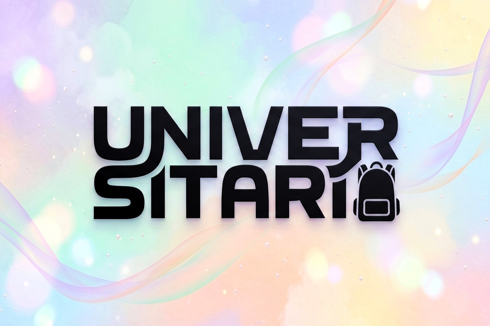

<div align="center">
	
</div>

<h1 align="center">Universitario</h1>

<p align="center">
	<strong>You pick the color.</strong><br />
	A colorful, eye-friendly Obsidian theme that follows the accent color you love.
</p>

<p align="center">
	<a href="https://github.com/wulflo/obsidian-3Sumaq/releases/latest"></a>
	
	<a href="LICENSE"></a>
</p>

<p align="center">
	
</p>

Universitario is a theme for people who cannot pick just one color — so the theme picks it with you. Choose any accent color in **Appearance** and the headings, highlights, callouts, and checkboxes adapt to it. The palette is softened in both light and dark mode to keep long reading and study sessions comfortable.

## ✨ Features

| | Feature | What it does |
| :--: | --- | --- |
| 🎨 | **Accent-driven palette** | Headings, highlights, tags, callouts, and UI details follow your Obsidian accent color. |
| 🌗 | **Tuned light & dark modes** | Both modes have their own softened, low-glare color values. |
| 🔠 | **Expressive headings** | Each heading level has a distinct accent shape: solid, outlined, dashed, or side-bordered. |
| 💬 | **Grouped callouts** | `supercallout` turns nested callouts into responsive columns. |
| 🗂️ | **Dataview cards** | Add `collage` to `cssclasses` to render a Dataview table as a card grid. |
| 🃏 | **List cards** | Add `list-cards` to `cssclasses` to turn a list into a card layout. |
| ⚡ | **Flashcard glow** | Add `#flashcard` (or `#card`) to a line to make it stand out as a recall prompt. |
| 🔢 | **Nested numbering** | Ordered lists are numbered hierarchically: `1.`, `1.1`, `1.1.1`, and so on. |
| 📊 | **Wide tables** | Add `maximize-tables-auto` to `cssclasses` for full-width tables. |
| 📱 | **Mobile-friendly** | Responsive spacing and sizing for phones and small screens. |

## 📦 Installation

### From the community theme browser

1. Open **Settings → Appearance → Themes**.
2. Click **Manage**, search for **Universitario**, and install it.
3. Select **Universitario** from the theme list.

### Manual installation

1. Download `manifest.json` and `theme.css` from the [latest release](https://github.com/wulflo/obsidian-3Sumaq/releases/latest).
2. Create this folder inside your vault:

   ```text
   <your-vault>/.obsidian/themes/Universitario/
   ```

3. Move both files into that folder.
4. Open **Settings → Appearance → Themes** and select **Universitario**.

> [!TIP]
> The folder name must be `Universitario` so Obsidian can match it with the `name` field in `manifest.json`.

## 🚀 Usage

### 🎨 Change the color

Go to **Settings → Appearance → Accent color** and pick any color. Universitario derives its headings, highlights, and callouts from that single choice — no extra configuration needed.

### 💬 Grouped callouts

Use `supercallout` as a wrapper and nest regular callouts inside it. Add `wide-2` through `wide-5` to a child callout to give it more horizontal space, or `min-0` to let it shrink.

```markdown
> [!supercallout]
> > [!note|wide-2]+ First Grouped Callout
> > Description text for your first callout.
> >
> > [!tip|min-0]+ Second Grouped Callout
> > Description text for your second callout.
```

### 🗂️ Dataview cards

Requires the [Dataview](https://github.com/blacksmithgu/obsidian-dataview) plugin. Add `collage` to the `cssclasses` property of a note, then use a Dataview table or query:

```yaml
---
cssclasses:
  - collage
---
```

```dataview
TABLE author, status, cover
FROM "Books"
SORT file.name ASC
```

### 🃏 List cards

Add `list-cards` to `cssclasses` and write a normal list:

```yaml
---
cssclasses:
  - list-cards
---

- First card
- Second card
- Third card
```

### ⚡ Flashcards

Add `#flashcard` to a line to give it a soft glow, or use `#card` for the same effect:

```markdown
The mitochondria is the powerhouse of the cell. #flashcard
```

### 🔢 Nested numbering

Use nested ordered lists and Universitario numbers them automatically:

```markdown
1. Cell biology
	1. Prokaryotic cells
	1. Eukaryotic cells
		1. Animal cells
		1. Plant cells
```

This renders as `1. Cell biology`, `1.1 Prokaryotic cells`, `1.1.1 Animal cells`, and so on.

### 📊 Wide tables

Add `maximize-tables-auto` to `cssclasses` to let tables use the full available width:

```yaml
---
cssclasses:
  - maximize-tables-auto
---
```

## 🎨 Customization

Universitario exposes its colors, spacing, and typography through CSS variables, so small tweaks are easy with a [CSS snippet](https://help.obsidian.md/snippets).

For example, widen the reading area:

```css
body {
	--file-line-width: 850px;
}
```

Or override the heading accent while keeping the rest of the palette:

```css
body {
	--color-headings: var(--text-accent);
}
```

Changes to the accent color, text font, and interface font can be made directly in **Settings → Appearance**.

## 🧩 Compatibility

- Requires **Obsidian 1.0.0** or newer.
- `collage` needs the **Dataview** plugin.
- The theme has been tested for personal use and may not be compatible with every plugin or snippet.
- If something looks wrong, try disabling snippets and other themes first, then [open an issue](https://github.com/wulflo/obsidian-3Sumaq/issues).

## ❓ FAQ

<details>
<summary><strong>Do I need Style Settings or any other plugin?</strong></summary>

No. Universitario works with the accent color and font options built into Obsidian. The optional `collage` layout is the only feature that needs an external plugin (Dataview).

</details>

<details>
<summary><strong>Does it work on mobile?</strong></summary>

Yes. The theme includes responsive styles and can be installed from Obsidian mobile using the community theme browser.

</details>

<details>
<summary><strong>Can I use Universitario with other snippets?</strong></summary>

Usually yes, but snippets that override the same variables or components may conflict. Disable them one by one to find the culprit if something looks off.

</details>

<details>
<summary><strong>How do I update the theme?</strong></summary>

Update it from **Settings → Appearance → Themes → Manage**, or replace `manifest.json` and `theme.css` with the files from the latest release if you installed it manually.

</details>

## 🤝 Contributing

Contributions are welcome! Bug reports, CSS fixes, new ideas, and documentation improvements are all appreciated.

Before opening a pull request, read [CONTRIBUTING.md](CONTRIBUTING.md). PRs that modify `theme.css` or `manifest.json` run the **Validate** workflow, which checks `theme.css` with `csstree-validator` and validates `manifest.json`.

## 🌟 Credits

- Inspired by the **Minimal**, **Vicious**, and **Prism** themes (MIT license), with a focus on simplicity.
- Includes parts of the **Cards** snippet (MIT license) and the **MultiColumn** snippet (GNU license).
- Theme and cover artwork by [Alonso](https://linktr.ee/rincontech).

## ☕ Support

If Universitario makes your notes a little more enjoyable, you can support the project here:

<div align="center">
	<a href="https://tecito.app/alonsoup" target="_blank" rel="noopener noreferrer">
		
	</a>
</div>

## 📄 License

Released under the [GNU General Public License v3.0](LICENSE).
